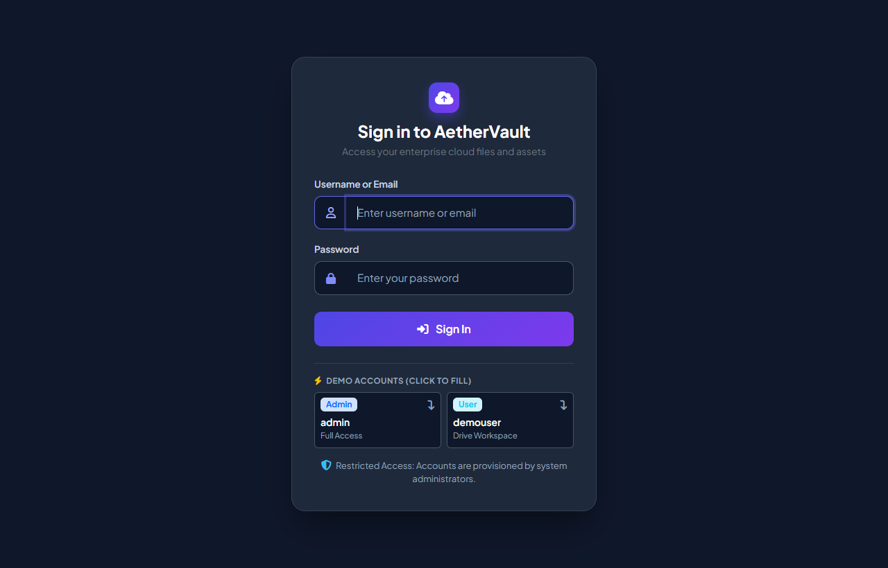
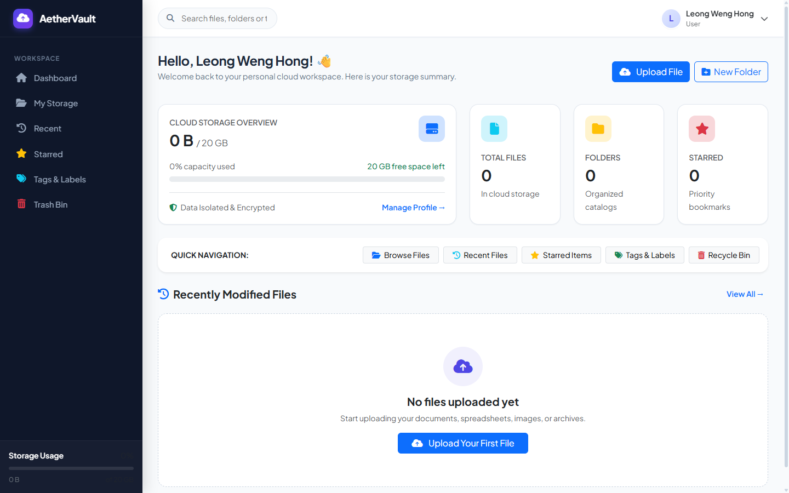
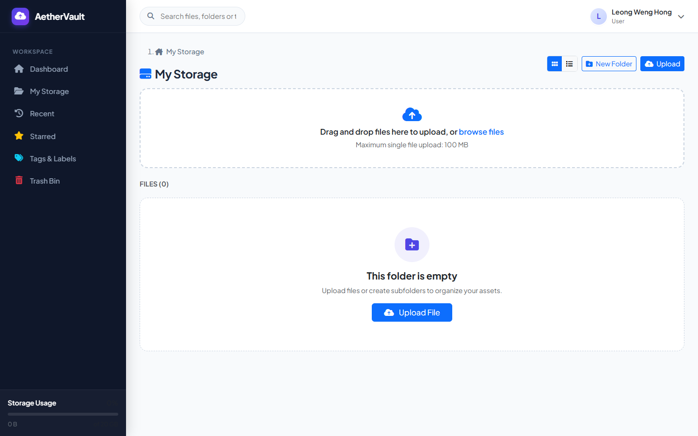
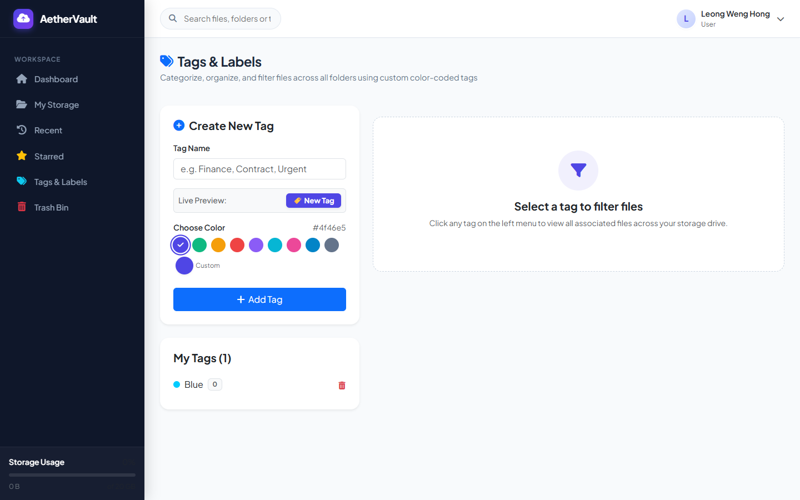
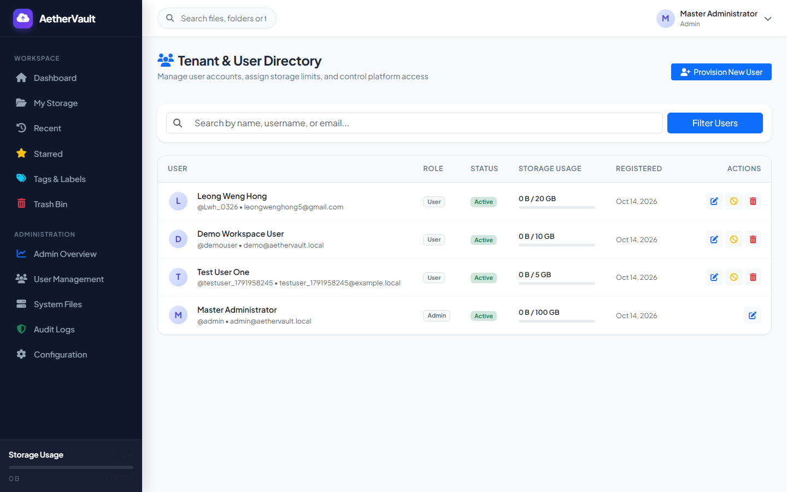
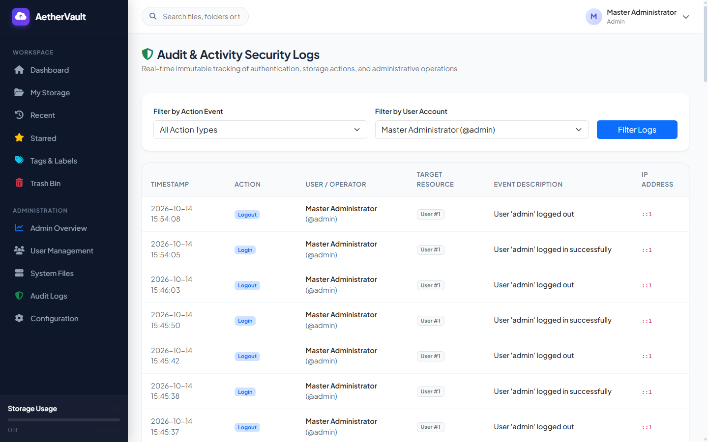

# AetherVault - Cloud Storage & Digital Asset Management System

A modern, self-hosted enterprise cloud drive and file management platform built with Native PHP and MySQL.

---

## 快速开始（XAMPP）

1. 将项目放置在 `C:\xampp\htdocs\drive_storage`
2. 启动 XAMPP 的 **Apache** 与 **MySQL**（默认端口 `3307` 或 `3306`）
3. 在浏览器打开 `http://localhost/drive_storage/`
4. 首次访问将自动引导进入安装向导，或直接使用已配置好的本地环境
5. 登录预设账号进行体验：
   - **管理员账号**：`admin` / 密码：`Admin@123456`
   - **普通演示账号**：`demouser` / 密码：`User@123456`
   - *(登录页面底部提供 Demo Accounts 快捷卡片，可一键自动填入)*
6. 开始上传文件、创建多级文件夹、添加彩色标签、生成加密分享外链或管理多版本历史

---

## Features

- **Modern SaaS UI**: Clean responsive interface with dark mode accents, micro-animations, and custom slim scrollbars.
- **Hierarchical File Explorer**: Multi-level nested folders, dynamic breadcrumbs, and dual-mode layout (**Grid View** & **List View**).
- **Starred Shortcuts**: Instant visual star markers on folders and files with real-time AJAX synchronization.
- **File Versioning & Rollback**: Upload new revisions without overwriting historical copies, with instant one-click rollback.
- **Color Tagging System**: Categorize assets with preset color swatches and native HTML5 color pickers.
- **Secure Public Sharing**: Cryptographically secure random tokens, optional bcrypt passwords, and expiration timers.
- **Recycle Bin (Soft Delete)**: Safe deletion, single-item restore, permanent purge, and configurable retention periods.
- **Multi-Tenant Administration**: Manage user accounts, customize individual storage quotas (GB), and toggle access status.
- **Global Audit Logging**: Immutable activity logs tracking IP addresses, actions, user agents, and resource IDs.
- **Automated Test Suite**: Built-in 32-point comprehensive verification suite (`test_suite.php`) ensuring 100% reliability.

---

## Screenshots

| Secure Sign-in | Dashboard Overview |
| :---: | :---: |
|  |  |
| **File Explorer & Starred Folders** | **Color Tagging Management** |
|  |  |
| **Tenant & User Directory** | **Security & Audit Logs** |
|  |  |

---

## Folder Structure

```text
drive_storage/
├── admin/                 Administrative control panel (users, files, logs, settings)
├── assets/                Design system stylesheets & client-side scripts
│   ├── css/style.css      Responsive SaaS CSS tokens, custom scrollbars, animations
│   └── js/app.js          AJAX helpers, star toggles, modal controllers, toasts
├── config/                Core configuration & database bootstrap
│   ├── config.php         Global constants, path definitions, dynamic BASE_URL
│   ├── database.php       PDO singleton connection manager
│   ├── database_config.php Local database credentials (Git-ignored)
│   └── database_config.example.php Template for new deployments
├── docs/                  Documentation assets
│   └── screenshots/       Real application screenshot captures
├── includes/              Reusable layouts & business logic modules
│   ├── auth.php           Session authentication & quota calculator
│   ├── functions.php      Security sanitizers, byte formatters, flash messages
│   ├── header.php         Topbar, user navigation, storage meter
│   ├── sidebar.php        Collapsible navigation sidebar
│   ├── footer.php         Common modal templates & script imports
│   └── storage.php        File system storage engine & path validation
├── install/               Web installation wizard & database schema
│   ├── index.php          Step-by-step graphical installer
│   └── schema.sql         MySQL database schema & default seeds
├── uploads/               Physical file storage directory (.htaccess protected)
│   ├── files/             Active obfuscated physical files
│   └── versions/          Historical revision archives
├── dashboard.php          User home dashboard & storage overview
├── files.php              Main file explorer (Grid & List views)
├── login.php              Secure dark-themed sign-in page
├── logout.php             Session termination handler
├── preview.php            In-browser preview & media streaming
├── download.php           Direct secure file & ZIP download handler
├── share.php              Public share link gateway
├── tags.php               Color tag manager & filtered views
├── versions.php           Revision history inspector & rollback controller
├── search.php             Global search across files, folders & tags
├── recent.php             Recently modified files feed
├── starred.php            Bookmarked items showcase
├── trash.php              Recycle bin & permanent shredder
├── test_suite.php         32-point automated test suite
├── .gitignore             Comprehensive privacy & credentials guard
└── LICENSE                MIT Open Source License
```

---

## 1. XAMPP Setup & Configuration

1. Clone or copy this repository to `C:\xampp\htdocs\drive_storage`.
2. Start **Apache** and **MySQL** in the XAMPP Control Panel.
3. Verify your MySQL port (typically `3306` or `3307` in XAMPP).
4. Configure database credentials:
   - Copy `config/database_config.example.php` to `config/database_config.php`
   - Adjust `port` to match your local MySQL configuration:
     ```php
     return [
         'host'     => '127.0.0.1',
         'port'     => 3307, // or 3306
         'dbname'   => 'aethervault_db',
         'user'     => 'root',
         'password' => '',
         'charset'  => 'utf8mb4'
     ];
     ```
5. Open your browser and navigate to:
   ```
   http://localhost/drive_storage/
   ```
6. Sign in with the default accounts:
   - **Administrator**: `admin` / `Admin@123456`
   - **Demo User**: `demouser` / `User@123456`

---

## 2. File & Directory Workflows

- **Upload Assets**: Drag and drop any document, spreadsheet, image, or archive into the upload zone, or click **Upload File**.
- **Folders & Nesting**: Click **New Folder** to create directory trees. Breadcrumbs provide quick navigation back to parent folders.
- **Star Folders & Files**: Click the star icon (`☆` / `★`) directly on folder or file cards for instant bookmarking.
- **Version Control**: Uploading a file with the same name preserves the previous version in the archive, allowing one-click rollbacks via **Versions**.
- **File Previews**: Supports PDF documents, images (`JPG`, `PNG`, `GIF`, `WebP`, `SVG`), audio (`MP3`, `WAV`), video (`MP4`, `WebM`), and code/text files directly in the browser.

---

## 3. Sharing & Public Links

- Click the **Share Link** option on any file or folder card.
- Customize your sharing parameters:
  - **Password Protection**: Restrict access with an optional password.
  - **Expiration Timer**: Set link expiration to 1 day, 7 days, 30 days, or unlimited.
- Recipients access a dedicated gateway (`share.php?token=...`) allowing browser previews, single downloads, or folder ZIP downloads.

---

## 4. Administration & Tenant Management

In the **Administration** sidebar section:
- **Admin Overview**: High-level platform statistics, cluster storage consumption, and active tenants.
- **User Management**: Provision new users, allocate custom storage quotas (e.g., `5 GB`, `20 GB`, `100 GB`), toggle active status, and reset credentials.
- **System Files**: View and search all physical files uploaded across the entire system.
- **Audit Logs**: Review a complete audit trail tracking IP addresses, user agents, timestamps, and action types.
- **Configuration**: Set maximum file upload size, default quotas, permitted file extensions, and trash retention days.

---

## 5. Automated Verification

The platform includes an automated 32-point test suite validating all security barriers, upload handlers, version rollbacks, and storage calculations:

```bash
php test_suite.php
```

All 32 tests execute against the active database and file system sandbox to verify operational health.

---

## 6. System Flow & Architecture

```text
[ User Action / Drag-and-Drop ]
             │
             ▼
      [ CSRF Validation ]
             │
             ▼
[ MIME & Extension Blacklist Check ]
             │
             ▼
 [ Scrambled Physical Disk Storage ]
             │
             ├──> [ Database Indexing (Files / Folders / Tags) ]
             ├──> [ Storage Quota Recalculation (Live Session Sync) ]
             └──> [ Immutable Audit Log Recording ]
```

---

## 7. Security Notes

- **Strict Tenant Isolation**: Users can only browse, search, download, and delete their own files and folders.
- **MIME & Extension Blacklist**: Executable files (`.php`, `.phtml`, `.exe`, `.bat`, `.sh`, `.cmd`, `.vbs`, `.js`) are strictly blocked on upload.
- **Physical Filename Obfuscation**: Files stored in `uploads/files/` use randomized MD5 hashes with user-specific timestamps (e.g. `9f8e7d..._179196.dat`) to prevent direct URL guessing.
- **Direct Execution Shield**: Both `uploads/` and `uploads/versions/` include strict `.htaccess` rules (`php_flag engine off`, `SetHandler none`) preventing server-side script execution.
- **Password Hashing**: All user passwords and share passwords use standard bcrypt (`PASSWORD_BCRYPT`).
- **Privacy Protection**: Database credentials and uploaded user files are shielded via `.gitignore`.

---

## License

This project is licensed under the [MIT License](LICENSE).